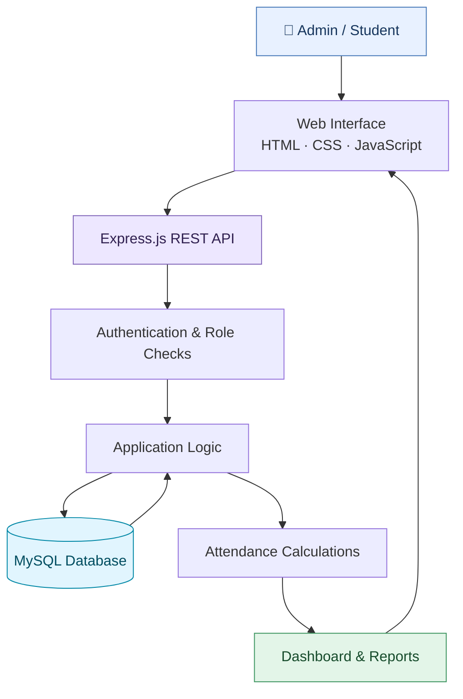
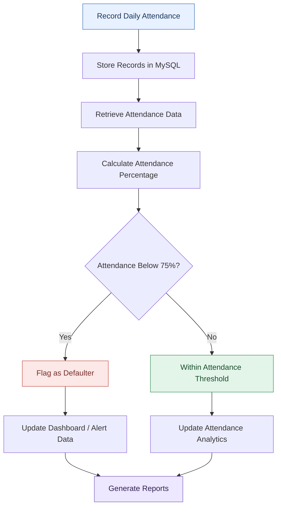
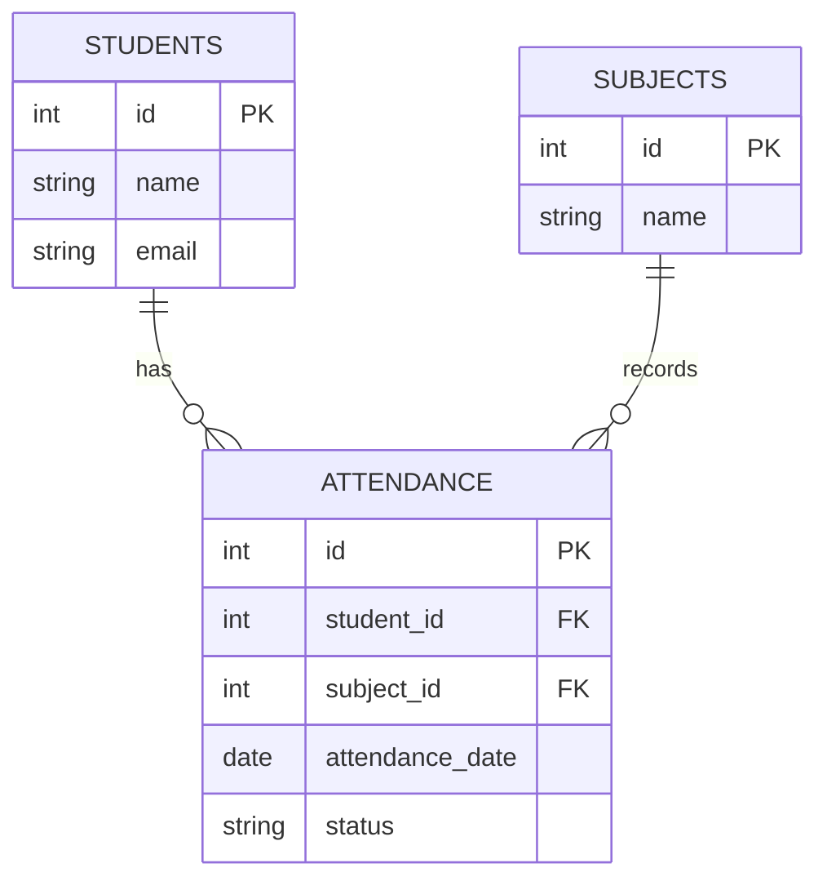

# 🎓 ATTENDX — Student Attendance Monitoring & Analytics System

### Transforming attendance records into actionable academic insights.

<p align="center">
  <strong>A Full-Stack Web Application for Attendance Management, Analytics, and Defaulter Detection</strong>
</p>

<p align="center">
  <a href="https://github.com/abhishek301104/Automated-Student-Attendance-Monitoring-and-Analytics-System">
    
  </a>
  
  
  
  
</p>

<p align="center">
  
  
</p>

---

## 📌 Overview

**ATTENDX** is a full-stack Student Attendance Monitoring and Analytics System designed to simplify attendance management and help identify students who may be at academic risk.

Traditional attendance registers and manual calculations can make it difficult to maintain accurate records, monitor attendance trends, and identify students falling below required attendance thresholds.

ATTENDX brings these activities into a centralized web application. It combines student and subject management, attendance recording, database-backed analytics, defaulter identification, and report generation in one interface.

The system includes separate Admin and Student experiences, helping administrators manage records while students can review their own attendance information.

### 🎯 Project Objectives

- Digitize daily attendance recording and record management.
- Reduce manual calculation and record-entry errors.
- Monitor attendance percentages at student and subject levels.
- Identify students whose attendance falls below the 75% threshold.
- Present attendance data through dashboard metrics and charts.
- Simplify attendance reporting through Excel and PDF exports.

---

## ✨ Core Features

### 🛡️ Admin Dashboard

- **Role-based access:** Separate administrator and student experiences.
- **Student management:** Add, edit, delete, and search student records.
- **Subject management:** Maintain subject information in MySQL.
- **Bulk attendance marking:** Record attendance for multiple students.
- **Attendance records:** Review records with filtering options.
- **Analytics dashboard:** View attendance KPIs, trends, and risk distribution.
- **Defaulter detection:** Flag students below the configured 75% threshold.
- **Low-attendance notifications:** Generate alerts for students with low attendance.
- **Report exports:** Download attendance reports in Excel and PDF formats.

### 👨‍🎓 Student Portal

- Personal student login.
- Subject-wise attendance percentages.
- Access to attendance records and history.

### 📱 User Experience

- Responsive interface for desktop and mobile screens.
- Browser-based application with a PWA manifest for an app-like experience.
- Centralized access to attendance data and reports.

---

## 🧭 System Architecture

ATTENDX uses a client-server architecture. The browser handles the user interface, Express.js processes application requests, and MySQL stores attendance and related records.



### Request and Data Flow

1. An administrator or student interacts with the frontend.
2. The frontend sends requests to the Express.js backend.
3. Authentication and role checks determine which actions are permitted.
4. The backend processes the request and reads or updates MySQL records.
5. Attendance data is aggregated into percentages and dashboard metrics.
6. Results are returned to the frontend and displayed to the user.

---

## 📊 Attendance Analytics Workflow

The analytics workflow converts attendance records into information that can help administrators identify students who need attention.



**Attendance percentage**

A common calculation is:

\[
\text{Attendance \%} =
\frac{\text{Classes Attended}}{\text{Total Classes Conducted}}
\times 100
\]

For example, if a student attends 36 out of 45 classes:

\[
\frac{36}{45}\times100=80\%
\]

That student is above the configured 75% threshold. A student with 30 attended classes out of 45 has 66.67% attendance and would be flagged under that rule.

*The calculation assumes that the application counts attendance and total conducted classes consistently for the selected subject or reporting period.*

---

## 🗄️ Database Design

MySQL provides persistent storage for student, subject, and attendance-related information.

The conceptual relationship between the main entities can be represented as follows. Adapt the diagram to your actual schema if the table names or relationships differ.



### Why a Relational Database?

- **Structured records:** Keep student, subject, and attendance information organized.
- **Relationships:** Link attendance entries to their associated students and subjects.
- **Querying:** Retrieve records for reports, filtering, and analytics.
- **Data consistency:** Use appropriate keys and constraints to maintain valid relationships.

The diagram illustrates a conceptual model, not a verified copy of the exact columns in `database/schema.sql`.

---

## 🛠️ Technology Stack

| Layer | Technology | Purpose |
|---|---|---|
| Backend | Node.js | JavaScript server runtime |
| API | Express.js | Routes, middleware, and request handling |
| Database | MySQL | Persistent relational data storage |
| Frontend | HTML5 | Page structure |
| Styling | CSS3 | Layout and responsive interface |
| Client logic | JavaScript | UI interactions and API communication |
| Authentication | JWT | Token-based authentication, if implemented as described |
| Reporting | Excel and PDF export | Downloadable attendance reports |
| Development | Git and GitHub | Version control and source-code hosting |

---

## 📂 Project Structure

```text
ATTENDX/
│
├── database/
│   └── schema.sql          # Database schema and demo data
│
├── public/
│   ├── index.html          # Frontend interface
│   ├── style.css           # Styling and responsive layout
│   ├── app.js              # Client-side application logic
│   └── ...                 # Other frontend/PWA assets
│
├── server.js               # Express server and API routes
├── .env.example            # Environment variable template
├── .gitignore              # Excluded files and secrets
├── package.json            # Scripts and dependencies
├── package-lock.json       # Dependency lockfile
└── README.md               # Project documentation
```

*This is a representative structure based on the project layout. Keep your actual filenames and folders in the README consistent with the repository.*

---

## 🚀 Run ATTENDX Locally

### Prerequisites

- [Node.js LTS](https://nodejs.org/)
- [MySQL Server](https://dev.mysql.com/downloads/mysql/)
- MySQL Workbench or another MySQL client
- Git (optional)

### Step 1 — Clone the Repository

```bash
git clone https://github.com/abhishek301104/Automated-Student-Attendance-Monitoring-and-Analytics-System.git
cd Automated-Student-Attendance-Monitoring-and-Analytics-System
```

### Step 2 — Install Dependencies

```bash
npm install
```

### Step 3 — Create the Database

1. Open MySQL Workbench.
2. Open `database/schema.sql`.
3. Execute the SQL script.
4. Confirm that the `attendx` database and its tables have been created.

**Important:** Back up existing data before running a schema script against an existing database.

### Step 4 — Configure Environment Variables

Copy the example configuration:

```powershell
Copy-Item .env.example .env
```

Open `.env` and configure the values expected by your backend:

```env
PORT=3000
DB_HOST=localhost
DB_USER=root
DB_PASSWORD=your_mysql_password
DB_NAME=attendx
JWT_SECRET=replace_with_a_long_random_secret
```

These are example variable names based on the documented configuration. Confirm that they match the variables read by `server.js`.

Never commit the real `.env` file or expose your database password or JWT secret.

### Step 5 — Start the Application

```bash
npm start
```

If the project defines a development script, you can also run:

```bash
npm run dev
```

Open the application in your browser:

**http://localhost:3000**

If port 3000 is already occupied, check whether an existing instance of ATTENDX is running before starting another one.

---

## 🔐 Environment Variables

| Variable | Description |
|---|---|
| `PORT` | Port used by the server |
| `DB_HOST` | MySQL host |
| `DB_USER` | MySQL username |
| `DB_PASSWORD` | MySQL password |
| `DB_NAME` | Database name |
| `JWT_SECRET` | Secret used to sign JWTs |

Use strong secrets and store them securely. The names above must match the implementation in your backend.

---

## 🧪 Demo Accounts

The following credentials are documented for local demonstration only. They should be verified against the seed data in `database/schema.sql`.

| Role | Email | Password |
|---|---|---|
| Admin | `admin@attendx.local` | `password123` |
| Student | `aarav@example.com` | `password123` |

**Security warning:** Do not use these demo passwords in a public or production deployment. Remove or replace demo accounts and use securely stored password hashes.

---

## 📱 Test on a Mobile Phone

To test the responsive interface on a phone connected to the same Wi-Fi network as your computer:

1. Start ATTENDX on your computer.
2. Run `ipconfig` in Windows PowerShell.
3. Find your computer's IPv4 address, such as `192.168.1.10`.
4. Open `http://192.168.1.10:3000` on your phone.
5. If the connection fails, check the Windows Firewall and ensure the server is listening on a network-accessible interface.

Use this only on a trusted network, and do not expose a development server or demo credentials to the public internet.

---

## 🔒 Security Considerations

ATTENDX is an academic/demo project. Before production deployment, review and implement the following where applicable:

- Secure password hashing and a strong password policy.
- Authentication and authorization checks on protected API routes.
- HTTPS for network traffic.
- Rate limiting and brute-force protection for login endpoints.
- Request validation and safe database queries.
- CSRF protections where applicable to the authentication mechanism.
- Secure secret management and removal of demo accounts.
- Audit logging, backups, and appropriate access controls.
- Privacy protections for student information and exported reports.

JWT authentication alone does not guarantee that the application is secure; the implementation and authorization checks must also be correct.

---

## 🛣️ Roadmap

- [ ] Add screenshots of the dashboard, attendance records, and reports.
- [ ] Add automated API and database tests.
- [ ] Add Docker and Docker Compose support.
- [ ] Add email or SMS delivery for attendance alerts.
- [ ] Improve analytics with date-range and subject comparisons.
- [ ] Add hosted deployment with managed database configuration.
- [ ] Document API endpoints and example responses.
- [ ] Add accessibility improvements and loading/error states.

---

## 👨‍💻 About the Developer

**Abhishek Kumar Dubey**  
B.Tech — Computer Science and Engineering  
Technocrats Institute of Technology, Bhopal

Interested in Python development, SQL, full-stack engineering, data analytics, and practical software applications.

- **GitHub:** [@abhishek301104](https://github.com/abhishek301104)
- **Project Repository:** [ATTENDX — Student Attendance Monitoring and Analytics System](https://github.com/abhishek301104/Automated-Student-Attendance-Monitoring-and-Analytics-System)

---

## 📄 License

This project is released under the [MIT License](LICENSE), provided the repository includes the corresponding license file.

---

<p align="center">
  <strong>ATTENDX — From Attendance Records to Actionable Insights.</strong>
</p>
